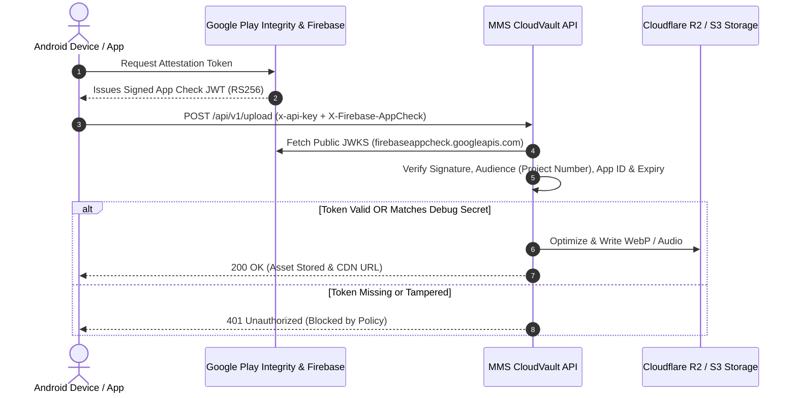

# 🛡️ Firebase App Check & Play Integrity Guide (MMS CloudVault)

> **Complete Operational Manual**: How to collect your Firebase Project Number, Mobile App IDs, and Device Debug Tokens, configure Google Play Integrity, and implement bulletproof hardware-backed attestation for your mobile apps.

---

## 📌 ১. ওভারভিউ: এটি কেন প্রয়োজন এবং কীভাবে কাজ করে?

মোবাইল অ্যাপ্লিকেশনের সোর্স কোড বা APK ফাইল যে কেউ রিভার্স-ইঞ্জিনিয়ার (Decompile) করে ভেতরের `x-api-key` বের করে নিতে পারে। যদি শুধু এপিআই কি ব্যবহার করা হয়, তবে যে কেউ সেই কি দিয়ে Postman বা cURL কমান্ডের মাধ্যমে সার্ভারে ফেক রিকোয়েস্ট পাঠাতে পারে।

**Firebase App Check + Google Play Integrity** এই সমস্যার ১০০% বুলেটপ্রুফ সমাধান:
1. **হার্ডওয়্যার অ্যাটাস্টেশন**: গুগল প্লে সার্ভিস ডিভাইসের হার্ডওয়্যার ও অপারেটিং সিস্টেম পরীক্ষা করে নিশ্চিত করে যে অ্যাপটি অরিজিনাল এবং অনুমোদিত ডিভাইস থেকে চলছে।
2. **ক্রিপ্টোগ্রাফিক টোকেন**: গুগল একটি ডিজিটাল সাইন করা JWT টোকেন ইস্যু করে।
3. **ক্লাউডভল্ট ভেরিফিকেশন**: সার্ভার গুগলের পাবলিক সার্টিফিকেট (`RS256 JWKS`) দিয়ে টোকেনটি ভেরিফাই করে। শুধুমাত্র ভেরিফাইড রিকোয়েস্টেই ফাইল আপলোড বা মিডিয়া অপারেশন সম্পন্ন হয়।



---

## 🔑 ২. কীভাবে মানগুলো সংগ্রহ (Collect) করবেন?

### স্টেপ ১: Firebase Project Number সংগ্রহ
1. [Firebase Console](https://console.firebase.google.com/) এ লগইন করুন।
2. আপনার প্রোজেক্টটি ওপেন করুন।
3. বাম পাশের মেনুর উপরে গিয়ার আইকনে ⚙️ ক্লিক করে **Project settings**-এ যান।
4. **General** ট্যাবের ভেতরে **Project number** দেখতে পাবেন (যেমন: `360194673797`)।
5. এই সংখ্যাটি কপি করে MMS CloudVault ড্যাশবোর্ডে **Firebase Project Number** বক্সে পেস্ট করুন।

---

### স্টেপ ২: Whitelisted Mobile App ID সংগ্রহ
> **নোট**: এটি কিন্তু শুধু প্যাকেজ নেম (`com.example.app`) নয়, এটি ফায়ারবেসের ইউনিক অ্যাপ আইডেন্টিফায়ার।

1. Firebase Console-এ **Project settings** -> **General** ট্যাবে নিচে স্ক্রোল করে **Your apps** সেকশনে যান।
2. আপনার Android অ্যাপটি সিলেক্ট করুন।
3. সেখানে **App ID** দেখতে পাবেন। এর ফরম্যাট হবে এমন:
   ```text
   1:123456789012:android:34a0ec8763261a9b
   ```
4. এটি কপি করে ড্যাশবোর্ডে **Whitelisted Mobile App IDs** বক্সে পেস্ট করুন।
5. আপনার যদি একাধিক অ্যাপ থাকে (যেমন: ইউজার অ্যাপ এবং ক্রিয়েটর অ্যাপ, অথবা Android + iOS), তবে কমা (`,`) দিয়ে একাধিক আইডি যুক্ত করতে পারেন:
   ```text
   1:123456789012:android:34a0ec8763261a9b, 1:123456789012:android:fedcba9876543210
   ```

---

### স্টেপ ৩: Firebase Console-এ Play Integrity সক্রিয় করা
1. Firebase Console-এর বাম পাশের মেনু থেকে **App Check**-এ ক্লিক করুন।
2. **Apps** ট্যাবে যান এবং আপনার Android অ্যাপটির পাশে **Register** অথবা **Manage** বাটনে ক্লিক করুন।
3. Attestation Provider হিসেবে **Play Integrity** সিলেক্ট করুন।
4. Token TTL ডিফল্ট (1 hour) রাখুন এবং **Save** করুন।
5. নিশ্চিত করুন আপনার অ্যাপের **SHA-256 fingerprint** ফায়ারবেস প্রোজেক্ট সেটিংসে যুক্ত করা আছে।

---

### স্টেপ ৪: Device Debug Secrets / Test Tokens সংগ্রহ ও ম্যানেজমেন্ট
> **সমস্যা**: আপনি যখন আপনার Mac, Windows/Linux ল্যাপটপ বা এমুলেটরে অ্যাপ ডেভেলপ ও টেস্ট করছেন, তখন অ্যাপটি গুগল প্লে স্টোর থেকে ডাউনলোড করা নয়। ফলে Play Integrity লাইভ টোকেন দিতে পারবে না।  
> **সমাধান**: Firebase App Check Debug Provider!

#### ১. Android Studio থেকে Debug Secret সংগ্রহ করবেন যেভাবে:
1. আপনার অ্যাপের `Application` ক্লাসে Debug Provider সেট করে অ্যাপটি এমুলেটর বা ফোনে রান করুন।
2. Android Studio-র নিচের **Logcat** উইন্ডো খুলুন।
3. সার্চ বক্সে ফিল্টার করুন: `AppCheck` অথবা `DebugAppCheckProvider`।
4. আপনি নিচের মতো একটি লগ দেখতে পাবেন:
   ```text
   D/DebugAppCheckProvider: Enter this debug secret into the allow list in the Firebase Console: 
   c3b52643-4e89-4a92-b4fa-4158d2348b61
   ```
5. এই UUID কোডটি (`c3b52643-4e89-4a92-b4fa-4158d2348b61`) কপি করুন।

#### ২. একাধিক ডিভাইস (Mac, Laptop, QA Devices) ম্যানেজ করার উপায়:
MMS CloudVault-এ আপনি ড্যাশবোর্ড থেকেই আনলিমিটেড ডিভাইসের জন্য ডিবাগ সিক্রেট ম্যানেজ করতে পারবেন:
1. MMS CloudVault ড্যাশবোর্ডে যান -> **API Keys** -> আপনার অ্যাপের পাশে **Security (Shield 🛡️)** বাটনে ক্লিক করুন।
2. **Device Debug Secrets / Test Tokens** বক্সে আপনার Mac এবং ল্যাপটপের টোকেনগুলো কমা দিয়ে পেস্ট করুন:
   ```text
   c3b52643-4e89-4a92-b4fa-4158d2348b61, a1b2c3d4-e5f6-7890-abcd-ef1234567890, test-pixel-emulator
   ```
3. **Save Security Policy** বাটনে ক্লিক করুন।
4. **জিরো সার্ভার রিস্টার্ট**: ড্যাশবোর্ডে সেভ করার সাথে সাথেই ডাটাবেসে আপডেট হয়ে যায়। কোনো সার্ভার রিস্টার্ট বা রিডিপ্লয় ছাড়া সাথে সাথে কাজ শুরু করবে!

---

## 📱 ৩. মোবাইল অ্যাপ ক্লায়েন্ট কোড ইমপ্লিমেন্টেশন

### ক. Android (Kotlin) ইমপ্লিমেন্টেশন

#### ১. `build.gradle.kts` (app module):
```kotlin
dependencies {
    // Firebase BoM
    implementation(platform("com.google.firebase:firebase-bom:33.7.0"))
    implementation("com.google.firebase:firebase-appcheck-playintegrity")
    
    // Debug builds only
    debugImplementation("com.google.firebase:firebase-appcheck-debug")
}
```

#### ২. `MainApplication.kt` (ইনিশিয়ালাইজেশন):
```kotlin
package com.mms.studio.app

import android.app.Application
import com.google.firebase.FirebaseApp
import com.google.firebase.appcheck.FirebaseAppCheck
import com.google.firebase.appcheck.debug.DebugAppCheckProviderFactory
import com.google.firebase.appcheck.playintegrity.PlayIntegrityAppCheckProviderFactory

class MainApplication : Application() {
    override fun onCreate() {
        super.onCreate()
        FirebaseApp.initializeApp(this)

        val appCheck = FirebaseAppCheck.getInstance()
        if (BuildConfig.DEBUG) {
            // Development: Uses local debug secret printed in Logcat
            appCheck.installAppCheckProviderFactory(
                DebugAppCheckProviderFactory.getInstance()
            )
        } else {
            // Production: Uses hardware-backed Play Integrity
            appCheck.installAppCheckProviderFactory(
                PlayIntegrityAppCheckProviderFactory.getInstance()
            )
        }
    }
}
```

#### ৩. OkHttp / Retrofit Interceptor (রিকোয়েস্টে টোকেন যুক্ত করা):
```kotlin
package com.mms.studio.app.network

import com.google.android.gms.tasks.Tasks
import com.google.firebase.appcheck.FirebaseAppCheck
import okhttp3.Interceptor
import okhttp3.Response

class CloudVaultAuthInterceptor(private val apiKey: String) : Interceptor {
    override fun intercept(chain: Interceptor.Chain): Response {
        val original = chain.request()
        val requestBuilder = original.newBuilder()

        // 1. Add standard MMS Studio API Key
        requestBuilder.header("x-api-key", apiKey)

        // 2. Fetch fresh App Check token
        try {
            val appCheckTokenTask = FirebaseAppCheck.getInstance().getAppCheckToken(false)
            val appCheckToken = Tasks.await(appCheckTokenTask)
            val token = appCheckToken.token
            if (!token.isNullOrEmpty()) {
                requestBuilder.header("X-Firebase-AppCheck", token)
            }
        } catch (e: Exception) {
            e.printStackTrace()
        }

        return chain.proceed(requestBuilder.build())
    }
}
```

---

### খ. Flutter ইমপ্লিমেন্টেশন

#### ১. `pubspec.yaml`:
```yaml
dependencies:
  firebase_core: ^3.8.0
  firebase_app_check: ^0.3.1+4
  http: ^1.2.2
```

#### ২. `main.dart`:
```dart
import 'package:flutter/foundation.dart';
import 'package:firebase_core/firebase_core.dart';
import 'package:firebase_app_check/firebase_app_check.dart';

void main() async {
  WidgetsFlutterBinding.ensureInitialized();
  await Firebase.initializeApp();

  await FirebaseAppCheck.instance.activate(
    androidProvider: kDebugMode 
        ? AndroidProvider.debug 
        : AndroidProvider.playIntegrity,
    appleProvider: kDebugMode 
        ? AppleProvider.debug 
        : AppleProvider.deviceCheck,
  );

  runApp(const MyApp());
}
```

#### ৩. API রিকোয়েস্ট পাঠানোর সময়:
```dart
import 'package:http/http.dart' as http;
import 'package:firebase_app_check/firebase_app_check.dart';

Future<void> uploadMediaFile(String filePath) async {
  final appCheckToken = await FirebaseAppCheck.instance.getToken();

  final headers = {
    'x-api-key': 'mms_sec_YOUR_KEY_HERE',
    if (appCheckToken != null) 'X-Firebase-AppCheck': appCheckToken,
  };

  final response = await http.post(
    Uri.parse('https://storage.sabbirmms.com/api/v1/upload'),
    headers: headers,
    body: ...,
  );
}
```

---

## 🧪 ৪. টেস্টিং ও ভেরিফিকেশন গাইডলাইন

### টেস্ট ১: Postman বা cURL দিয়ে অনুমোদনবিহীন রিকোয়েস্ট পরীক্ষা
যদি কোনো এপিআই কি-তে `enforce_app_check = true` সক্রিয় থাকে, তবে Postman দিয়ে রিকোয়েস্ট পাঠালে সাথে সাথে ব্লক হবে:
```bash
curl -X POST https://storage.sabbirmms.com/api/v1/upload \
  -H "x-api-key: mms_sec_YOUR_KEY" \
  -F "asset_id=test_banner" \
  -F "file=@image.png"
```
**রেসপন্স:**
```json
{
  "error": "Firebase App Check attestation token is required for this API Key. Ensure your mobile client passes the X-Firebase-AppCheck header.",
  "code": "APP_CHECK_TOKEN_REQUIRED"
}
```

---

### টেস্ট ২: লোকাল ডিবাগ সিক্রেট দিয়ে ভেরিফিকেশন
আপনার ড্যাশবোর্ডে যদি `mac-debug-secret-1` ডিবাগ টোকেন হিসেবে অ্যাড করা থাকে:
```bash
curl -X POST http://localhost:3000/api/v1/upload \
  -H "x-api-key: mms_sec_YOUR_KEY" \
  -H "X-Firebase-AppCheck: mac-debug-secret-1" \
  -F "asset_id=test_dev_01" \
  -F "file=@sample.png"
```
**রেসপন্স:**
```json
{
  "success": true,
  "asset_id": "test_dev_01",
  "public_url": "https://storage.sabbirmms.com/banners/test_dev_01.webp",
  "blurhash": "LEHLk[WB2yk8pyo0adRj00WV8qWB"
}
```
*সার্ভার ডিবাগ টোকেনটি ম্যাচ করার সাথে সাথে ইনস্ট্যান্টলি ভ্যালিডেশন পাস করিয়ে মিডিয়া প্রসেস সম্পন্ন করবে!*

---

## 📋 ৫. সামারি চেকলিস্ট

| আইটেম | কোথায় পাবেন? | ক্লাউডভল্ট ড্যাশবোর্ডে ব্যবহার |
|---|---|---|
| **Firebase Project Number** | Firebase Console -> Project Settings -> General | `Firebase Project Number` ফিল্ড |
| **Mobile App ID** | Firebase Console -> Project Settings -> Your Apps -> App ID | `Whitelisted Mobile App IDs` ফিল্ড |
| **Play Integrity Provider** | Firebase Console -> App Check -> Apps -> Android | ফায়ারবেসে রেজিস্টার করতে হবে |
| **Debug Secret Token** | Android Studio Logcat (`AppCheck`) | `Device Debug Secrets / Test Tokens` ফিল্ড |

---

© 2026 MMS CloudVault. Designed for High-Security Mobile Media Ecosystems.

## Shared API for Android and web clients

Use the same `/api/v1/upload` and `/api/v1/assets/{asset_id}` routes everywhere.
App Check enforcement is configured per API key. If disabled, the API key alone
is sufficient; if enabled, the client must also provide an accepted App Check
token. Register the appropriate Firebase attestation provider for each client
(Android or web) and include its Firebase App ID in the allowed list. The
`firebaseProjectId` API/database field name remains unchanged for compatibility,
but its value is the numeric Firebase project number, not the textual project ID.
