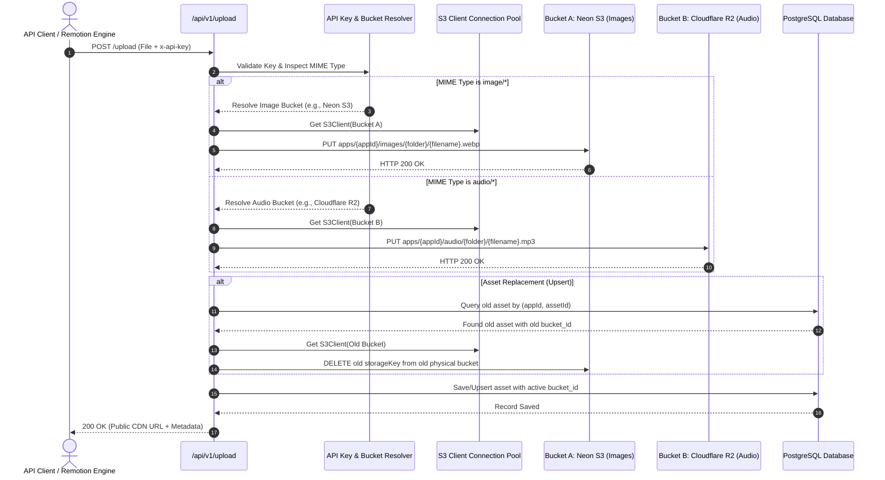

# MMS CloudVault — Multi-Bucket Storage Architecture Blueprint (v2.0)

**Status**: Architecture Standard & Implementation Roadmap  
**Target Capability**: MIME-Type Multi-Cloud Routing, Single API Key Dual-Bucket Dispatch, Zero-Legacy DB-Driven Storage  
**Applicable Version**: MMS CloudVault v2.0  

---

## 1. Executive Summary & Core Philosophy

### Fresh Architecture Directive (Zero-Legacy / Zero-Fallback)
The application is in active early development and has not been publicly released. Therefore:
- **No Backward Compatibility / No Legacy Bridges**: We completely eliminate `.env`-based object storage fallbacks (`STORAGE_ENDPOINT`, `STORAGE_ACCESS_KEY`, `STORAGE_SECRET_KEY`, etc.).
- **Single Source of Truth (SSOT)**: 100% of storage configurations, credentials, bucket endpoints, and CDN domains reside inside the PostgreSQL database (`storage_buckets` table).
- **MIME-Type Driven Multi-Bucket Routing**: A single API key can automatically route different media formats to distinct cloud storage providers:
  - `image/*` (WebP, PNG, JPG) -> Routed to **Bucket A** (e.g. Neon S3 or AWS S3).
  - `audio/*` (MP3, WAV, AAC) -> Routed to **Bucket B** (e.g. Cloudflare R2 with $0 egress fees).
  - Default / Other -> Routed to the key's designated default bucket.
- **Traceable Physical Asset Ownership**: Every media asset row in `media_assets` stores `bucket_id`. When replaced (upsert) or deleted, the system fetches the physical credentials of that exact bucket and removes the file. Zero orphaned files across multiple clouds!

---

## 2. MIME-Type Multi-Bucket Routing Lifecycle



---

## 3. Database Schema Design (PostgreSQL / Drizzle ORM)

### 3.1 New Table: `storage_buckets`
```typescript
export const storageBuckets = pgTable("storage_buckets", {
  id: uuid("id")
    .default(sql`gen_random_uuid()`)
    .primaryKey(),
  name: text("name").notNull(), // e.g. "Neon S3 Vault", "Cloudflare R2 Audio"
  slug: text("slug").notNull().unique(), // e.g. "neon-images", "r2-audio"
  provider: text("provider").notNull().default("s3_compatible"), // "s3_compatible" | "aws" | "cloudflare_r2" | "minio"
  
  // Storage Connection Credentials (Encrypted/Stored in DB)
  endpoint: text("endpoint").notNull(), // e.g. "https://br-still-snow-aoeg0x94.storage.c-2.ap-southeast-1.aws.neon.tech"
  bucketName: text("bucket_name").notNull(), // e.g. "mms-cloud-vault"
  region: text("region").notNull().default("auto"),
  accessKeyId: text("access_key_id").notNull(),
  secretAccessKey: text("secret_access_key").notNull(),
  
  // Public Delivery Base URL (Optional custom CDN domain)
  publicBaseUrl: text("public_base_url"), // e.g. "https://cdn.sabbirmms.com"
  
  // Status & Quota Management
  isDefault: boolean("is_default").notNull().default(false), // Global default bucket
  isActive: boolean("is_active").notNull().default(true),
  maxCapacityGb: integer("max_capacity_gb").default(5), // 5 for Neon free tier, 0 for unlimited
  usedBytes: bigint("used_bytes", { mode: "number" }).default(0),

  createdAt: timestamp("created_at", { withTimezone: true })
    .default(sql`CURRENT_TIMESTAMP`)
    .notNull(),
  updatedAt: timestamp("updated_at", { withTimezone: true })
    .default(sql`CURRENT_TIMESTAMP`)
    .notNull(),
});
```

### 3.2 Updates to `api_keys` Table
Add granular storage routing per API key:
```typescript
export const apiKeys = pgTable("api_keys", {
  // Existing columns: id, appName, appId, secretKey, isActive, createdAt, revokedAt...
  
  // Granular Bucket Bindings:
  defaultBucketId: uuid("default_bucket_id").references(() => storageBuckets.id, { onDelete: "set null" }),
  imageBucketId: uuid("image_bucket_id").references(() => storageBuckets.id, { onDelete: "set null" }),
  audioBucketId: uuid("audio_bucket_id").references(() => storageBuckets.id, { onDelete: "set null" }),
});
```

### 3.3 Updates to `media_assets` Table
Bind physical asset location permanently:
```typescript
export const mediaAssets = pgTable("media_assets", {
  // Existing columns: id, appId, assetId, title, folder, storageKey, publicUrl, ...
  
  // Physical Bucket Pointer:
  bucketId: uuid("bucket_id")
    .references(() => storageBuckets.id, { onDelete: "restrict" })
    .notNull(),
});
```

---

## 4. Folder Structure Standardization

Inside each physical bucket, keys follow a strict, human-readable hierarchy:

```
Bucket Root/
├── apps/
│   ├── {app_id}/
│   │   ├── images/
│   │   │   ├── {folder or 'general'}/
│   │   │   │   └── asset_{asset_id}_{timestamp}.webp
│   │   └── audio/
│   │       ├── {folder or 'general'}/
│   │       │   └── asset_{asset_id}_{timestamp}.mp3
```

- **Images Bucket**: Stores WebP optimized graphics, thumbnails, and channel assets.
- **Audio Bucket**: Stores Voiceovers (ElevenLabs), SFX, and BGM tracks.

---

## 5. Implementation Roadmap (Phased Execution)

### Phase 1: Database Schema & Migration
1. Update `src/db/schema.ts` with `storageBuckets` table and relations on `apiKeys` & `mediaAssets`.
2. Execute `npm run db:push` to apply changes directly to PostgreSQL.
3. Seed the existing Neon S3 credentials into `storage_buckets` as the initial active default bucket and associate existing `media_assets` and `api_keys`.

### Phase 2: Storage Pool & Multi-Bucket Dynamic Engine
1. Create `src/lib/storage-pool.ts` using LRU Cache for managing dynamic `S3Client` instances per bucket ID.
2. Refactor `src/lib/storage.ts` to accept explicit bucket credentials (eliminating `process.env` storage reliance).
3. Update `src/lib/asset-manager.ts` to inspect MIME types, resolve the appropriate bucket, upload to the target S3 instance, and record `bucketId`.
4. Update `deleteObject` and trash manager to look up the asset's `bucketId` and delete from the exact originating cloud bucket.

### Phase 3: Admin Dashboard UI/UX
1. **Site Settings (`/dashboard/settings`)**:
   - Add "Storage Buckets" management tab.
   - List connected buckets with status chips (`Default`, `Active`, `Neon S3`, `Cloudflare R2`).
   - "Add New Storage Bucket" dialog with live "Test S3 Connection" action.
   - Capacity indicators showing used storage vs max capacity.
2. **API Keys Management (`/dashboard/api-keys`)**:
   - In Create/Edit API Key modal, add:
     - Default Bucket selector.
     - Dedicated Image Bucket selector (optional).
     - Dedicated Audio Bucket selector (optional).
3. **Media Gallery (`/dashboard/gallery`)**:
   - Display a subtle cloud provider badge on each media card (e.g. `Neon`, `R2`).

### Phase 4: Verification & Automated Testing
1. Update `scripts/run-full-verification.ts` to test:
   - Dynamic bucket registration.
   - Dual-bucket routing with a single API key (image upload to Bucket A, audio upload to Bucket B).
   - Old asset replacement/upsert across different buckets.
   - Soft delete & permanent delete from the exact bucket.
