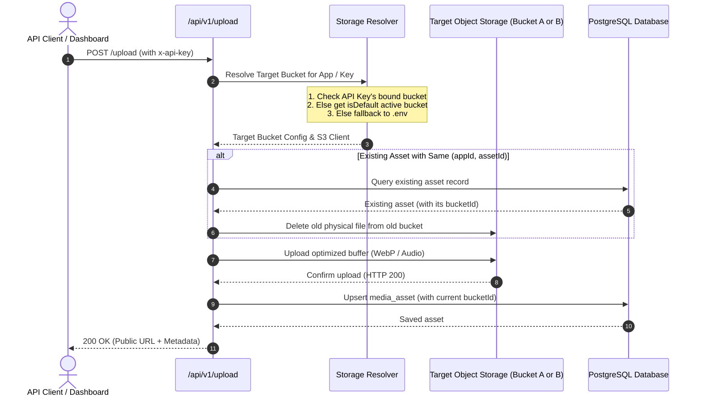

# MMS CloudVault — Multi-Bucket Storage Architecture Blueprint

**Status**: Proposal & Architecture Blueprint  
**Target Capability**: Dynamic Multi-Bucket Routing, Per-App Storage Isolation, Multi-Cloud Overflow  
**Applicable Version**: MMS CloudVault v2.0 Architecture  

---

## 1. Executive Summary & Problem Definition

### Current Architecture (v1.0)
- Single static bucket configuration defined in `.env.local` (`STORAGE_ENDPOINT`, `STORAGE_BUCKET_NAME`, etc.).
- Hard storage quota ceiling (e.g., Neon S3 Free Tier 5 GB limit).
- All applications (`app_id`) share the identical physical bucket namespace.
- Switching buckets requires environment variable changes, manual database migrations, and downtime.

### Target Architecture (v2.0)
- **Database-Driven Bucket Registry**: Buckets are dynamically registered, activated, and managed from the Admin Dashboard (`/dashboard/settings`).
- **Dynamic Routing Engine**:
  - **Option A (Per-App/API-Key Binding)**: App A routes to Bucket A (e.g. Neon S3), App B routes to Bucket B (e.g. Cloudflare R2).
  - **Option B (Active Cascade / Overflow)**: New uploads automatically go to the currently designated "Active" bucket.
- **Traceable Asset Ownership**: Every media item records its `bucket_id`. When replaced or deleted, the system deletes the physical file from the exact bucket where it resides, regardless of which bucket is currently active.
- **Zero-Downtime Expansion**: Seamlessly add a 2nd, 3rd, or 4th bucket without touching `.env` or breaking previous URLs.

---

## 2. Database Schema Design (Drizzle ORM)

### New Table: `storage_buckets`

```typescript
// src/db/schema.ts

export const storageBuckets = pgTable("storage_buckets", {
  id: text("id")
    .primaryKey()
    .$defaultFn(() => crypto.randomUUID()),
  name: text("name").notNull(), // e.g. "Primary Neon S3", "Cloudflare R2 Media"
  slug: text("slug").notNull().unique(), // e.g. "neon-primary", "r2-audio"
  provider: text("provider").notNull().default("s3_compatible"), // "s3_compatible", "aws", "cloudflare_r2", "minio"
  
  // Storage Connection Credentials
  endpoint: text("endpoint").notNull(), // e.g. "https://<account>.r2.cloudflarestorage.com"
  bucketName: text("bucket_name").notNull(), // e.g. "mms-media-vault-01"
  region: text("region").notNull().default("auto"),
  accessKeyId: text("access_key_id").notNull(),
  secretAccessKey: text("secret_access_key").notNull(),
  
  // Public Delivery Base URL (Optional custom CDN domain)
  publicBaseUrl: text("public_base_url"), // e.g. "https://cdn.sabbirmms.com"
  
  // Quota & Status Management
  isDefault: boolean("is_default").notNull().default(false), // Only one active default bucket
  isActive: boolean("is_active").notNull().default(true),
  maxCapacityGb: integer("max_capacity_gb").default(5), // e.g. 5 for free tiers, 0 for unlimited
  usedBytes: bigint("used_bytes", { mode: "number" }).default(0),

  createdAt: timestamp("created_at").defaultNow().notNull(),
  updatedAt: timestamp("updated_at").defaultNow().notNull(),
});
```

### Table Relationships & Updates

1. **`api_keys` Table**:
   - Add nullable column `storageBucketId`:
     ```typescript
     storageBucketId: text("storage_bucket_id").references(() => storageBuckets.id, { onDelete: "set null" }),
     ```
   - If an API key has a `storageBucketId`, all uploads authorized by this key are routed to that specific bucket.
   - If `storageBucketId` is `null`, it falls back to the system's `isDefault: true` bucket.

2. **`media_assets` Table**:
   - Add column `bucketId`:
     ```typescript
     bucketId: text("bucket_id").references(() => storageBuckets.id, { onDelete: "set null" }),
     ```
   - When an asset is uploaded, its originating `bucketId` is permanently saved.
   - During deduplication, upsert, soft delete, or permanent delete, the system reads `asset.bucketId` to resolve the exact S3 client and bucket to delete the previous file.

---

## 3. Dynamic S3 Client Resolver & Connection Pool

Instead of instantiating one global `S3Client`, implement a cached connection manager:

```typescript
// src/lib/storage-pool.ts

import { S3Client } from "@aws-sdk/client-s3";
import { LRUCache } from "lru-cache";

// Cache S3Client instances by bucket ID with a 1-hour TTL
const clientPool = new LRUCache<string, S3Client>({
  max: 20,
  ttl: 1000 * 60 * 60,
});

export function getS3ClientForBucket(bucketConfig: {
  id: string;
  endpoint: string;
  region: string;
  accessKeyId: string;
  secretAccessKey: string;
}): S3Client {
  const cached = clientPool.get(bucketConfig.id);
  if (cached) return cached;

  const client = new S3Client({
    region: bucketConfig.region,
    endpoint: bucketConfig.endpoint,
    credentials: {
      accessKeyId: bucketConfig.accessKeyId,
      secretAccessKey: bucketConfig.secretAccessKey,
    },
    forcePathStyle: true,
  });

  clientPool.set(bucketConfig.id, client);
  return client;
}

export function invalidateClientPool(bucketId?: string) {
  if (bucketId) {
    clientPool.delete(bucketId);
  } else {
    clientPool.clear();
  }
}
```

---

## 4. Upload & Deletion Lifecycle



---

## 5. Admin Dashboard Features

1. **Storage Buckets Tab (`/dashboard/settings#buckets`)**:
   - List of all connected buckets with providers (Neon, Cloudflare R2, AWS S3, MinIO).
   - Live quota meter: e.g., `3.8 GB / 5.0 GB used (76%)`.
   - "Test Connection" button before saving.
   - "Set as Active Default" toggle.
2. **API Key Bucket Selector (`/dashboard/api-keys`)**:
   - When creating or editing an API key, a dropdown allows assigning a dedicated storage bucket or selecting "Default System Bucket".

---

## 6. Migration & Backward Compatibility Strategy

- **100% Backward Compatible**: Existing assets without a `bucket_id` will fall back to reading the default `.env` configuration.
- **Auto-Seeding**: A migration script can automatically read `.env.local` and insert the current Neon S3 bucket as `isDefault: true` in `storage_buckets`, so existing data seamlessly connects without any manual intervention.
